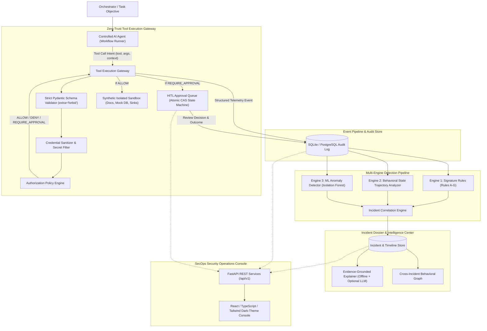

# AegisAI: Autonomous AI Agent Behavioral Security & Threat Investigation Platform
### An Empirical Research & Engineering Platform for Zero-Trust Tool Mediation, Human-in-the-Loop Governance, and Multi-Step Behavioral Attack Detection

[](https://www.python.org/)
[](https://fastapi.tiangolo.com)
[](https://react.dev)
[](https://www.typescriptlang.org/)
[](https://docs.pytest.org/)
[](https://opensource.org/licenses/MIT)

---

## 1. Research Overview & Problem Statement

As autonomous AI agents acquire capabilities to execute tools (filesystem reading/writing, database queries, web browsing, REST API requests, and calculation), they expose critical security vulnerabilities:
1. **Indirect Prompt Injection**: Adversarial instructions hidden inside ingested untrusted documents or web pages hijack agent intent and trigger unauthorized downstream tool invocations.
2. **Privilege Creep & Scope Violations**: Agents request operations outside their mandated operational objective (e.g. attempting to read internal compensation records during a document summarization task).
3. **Multi-Step Behavioral Sequences**: Advanced agent compromise rarely occurs in a single step; attackers stage stealthy reconnaissance, probe file structures, read credentials, and exfiltrate data through sequences where each individual tool invocation appears benign in isolation.
4. **Passive Observability Gaps**: Traditional security monitoring only flags an attack *after* it executes. A resilient AI security architecture requires **zero-trust pre-execution mediation** where high-privilege actions are intercepted, evaluated, and paused or blocked before touching resources.

### Core Research Questions
* **Primary Question**: Can combining least-privilege authorization policies, stateful behavioral sequence analysis, and unsupervised ML anomaly detection detect and prevent suspicious AI-agent behavior more effectively than isolated rule-based filtering?
* **Secondary Question**: Can the multi-engine system generalize to detect previously unseen zero-day attack sequences that were not explicitly encoded into static rule signatures?
* **Governance Question**: Can Human-in-the-Loop (HITL) approval workflows safely pause high-privilege agent operations while preventing race conditions, double execution, credential leaks, and process-interruption deadlocks?

---

## 2. System Architecture



---

## 3. Component Architecture & Responsibilities

| Component | Responsibility | Guarantees & Constraints |
| :--- | :--- | :--- |
| **Controlled AI Agent** (`app.agent.controlled_agent`) | Executes simulated goal-directed tasks (document summarization, database analysis) strictly via tool requests. | Possesses **zero** direct access to host OS, subprocesses, sockets, or real files. |
| **Synthetic Sandbox** (`app.agent.environment`) | Sandboxed directory holding public files, private audit reports, synthetic test honeytokens, and mock enterprise database. | Enforces canonical directory containment via `os.path.commonpath`. Traversal attempts raise immediate errors. |
| **Tool Execution Gateway** (`app.security.gateway`) | Zero-trust mediator intercepting all tool invocations before execution. Evaluates policy, verifies parameter schemas, redacts credentials, and manages execution lifecycle. | Fail-closed: Unmapped tools, invalid parameter types, unexpected kwargs, or policy violations default to `DENY` before reaching resources. |
| **Strict Tool Validator** (`app.schemas.tools`) | Typed Pydantic V2 schemas with `extra="forbid"` for all 8 agent tools. | Blocks parameter injection, enforces URL scheme whitelists (`http`/`https`), and validates numerical bounds. |
| **Secret Sanitizer** (`app.core.sanitizer`) | Recursive secret redaction utility masking tokens, AWS keys, private keys, passwords, and URL credentials across logs, API serialization, and errors. | Disallows unencrypted sensitive credentials from entering deferred approval storage. |
| **HITL Approval Engine** (`app.security.gateway`) | Manages deferred execution for high-privilege actions (e.g. filesystem writes, destructive queries). Implements atomic Compare-and-Swap state transitions (`PENDING -> IN_PROGRESS -> EXECUTED`). | Prevents duplicate execution under multi-threaded concurrency. Enforces 5-minute lease timeout with fail-closed recovery. |
| **Authorization Policy Engine** (`app.security.policy_engine`) | Evaluates proposed operations against agent manifests: tool whitelists, resource globs, allowed operations, and anti-brute force thresholds. | Deterministic least-privilege evaluation returning `ALLOW`, `DENY`, or `REQUIRE_APPROVAL`. |
| **Rule-Based Detector** (`app.security.rule_detector`) | Detects known signatures: credential probing (Rule B), unapproved exfiltration (Rule C), sandbox escapes (Rule F), repeated denial storms (Rule E). | Zero latency, high precision, produces exact policy clause explanations. |
| **Behavioral Sequence Analyzer** (`app.security.sequence_detector`) | Translates events into behavioral state trajectories (`BENIGN_READ -> SCOPE_PROBE -> CREDENTIAL_PROBE`) to identify multi-step escalation attacks. | Detects threats that appear benign when evaluated as isolated tool calls. |
| **ML Anomaly Detector** (`app.security.ml_detector`) | Extracts 8 engineered behavioral features per session; employs Isolation Forest and statistical deviance to detect out-of-distribution drift. | Generalizes to novel zero-day trajectories without hardcoded keyword rules. |
| **Incident Correlation Engine** (`app.security.correlation_engine`) | Correlates security events within a session, builds chronological attack graphs, links evidence event IDs, and assigns risk severity tiers. | Automatically escalates severity upon multi-vector triggers and locks down quarantined sessions. |
| **Investigation Dossier Engine** (`app.investigation.explainer`) | Reconstructs chronological timelines citing verified event IDs. Features reproducible offline narrative synthesis and optional external LLM provider integration. | Hallucination-resistant: Factual assertions strictly reference verified database `event_id` records. |
| **Threat Intelligence Correlator** (`app.investigation.threat_intel`) | Computes Jaccard/cosine behavioral overlap and clusters incidents by shared targets and sequence patterns. | Behavioral similarity only: explicitly disclaims real-world human attribution. |
| **Simulation Lab & Benchmarks** (`app.evaluation.benchmark_runner`) | Runs standardized benchmark suites across benign workflows, prompt injections, and unseen attack trajectories. | Computes empirical Precision, Recall, F1, FPR, FNR, Latency, and Gateway Blocking Effectiveness. |

---

## 4. Threat Model & Safeguards

| Threat Vector | Agent Attack Vector | Gateway Mitigation | Detection & Investigation |
| :--- | :--- | :--- | :--- |
| **Indirect Prompt Injection** | Untrusted document instructs agent to ignore goal and exfiltrate honeytoken credentials. | Gateway evaluates file path against policy blacklist; denies read with `DENY`. | Rule B flags honeytoken; Sequence Analyzer flags injection-to-exfil trajectory. |
| **Sandbox Path Traversal** | Agent supplies `../../etc/passwd` or `..\private\audit.csv` to escape sandbox. | Canonical path validation halts resolution; Gateway flags directory escape attempt. | Rule F triggers critical incident; session denial count increments. |
| **Privilege Escalation** | Reader agent requests `filesystem_write` or destructive database modification. | Whitelist policy check rejects tool invocation before execution. | Rule D flags prohibited operation; zero writes occur on disk. |
| **Unauthorized Exfiltration** | Agent calls external mock endpoint `https://attacker-mock-sink.net/exfil`. | Whitelist check verifies domain against `allowed_network_domains`. Non-approved domains blocked. | Rule C triggers high alert; staged data intercepted. |
| **Stealthy Tool Hopping** | Unseen attack sequence interleaves benign calculations with atypical tool transitions. | Gateway evaluates operation scopes; Anomaly detector scores multivariate deviance. | ML Anomaly detector scores session as out-of-distribution anomaly. |
| **Approval Replay & Race** | Concurrent threads attempt to approve the exact same pending action twice. | Atomic CAS state transition (`PENDING -> IN_PROGRESS`) guarantees exactly one thread claims execution; loser receives HTTP 409 Conflict. | Stale lease timeout fails closed without re-executing uncertain actions. |

---

## 5. Getting Started & Installation

### Prerequisites
* **Python**: 3.10, 3.11, 3.12, 3.13, or 3.14
* **Node.js**: v18+ (Node v20 or v22 LTS recommended)
* **npm**: v9+

### A. Clone and Setup Backend
```bash
# Clone the repository
git clone https://github.com/yeshwanthreddynandigala-hub/AegisAI.git
cd AegisAI

# Create and activate Python virtual environment
python -m venv venv

# Windows PowerShell:
.\venv\Scripts\Activate.ps1
# Linux / macOS:
# source venv/bin/activate

# Install all backend dependencies
pip install -r requirements.txt
```

### B. Setup and Build Frontend
```bash
# From project root:
cd frontend
npm install
npm run build
```

---

## 6. Running the System

### Step 1: Seed Demonstration Telemetry
Populate the SQLite database with benchmark scenarios, generating real telemetry, detected incidents, and correlation clusters:
```bash
# From AegisAI root directory:
# Windows PowerShell:
$env:PYTHONPATH="backend"
.\venv\Scripts\python.exe backend/app/core/seed.py

# Linux / macOS:
# PYTHONPATH=backend python backend/app/core/seed.py
```

### Step 2: Start the FastAPI Backend Server
```bash
# Windows PowerShell:
$env:PYTHONPATH="backend"
.\venv\Scripts\uvicorn.exe app.main:app --host 127.0.0.1 --port 8000 --reload

# Linux / macOS:
# PYTHONPATH=backend uvicorn app.main:app --host 127.0.0.1 --port 8000 --reload
```
Interactive OpenAPI documentation will be accessible at: **`http://127.0.0.1:8000/docs`**

### Step 3: Start the React SecOps Console
In a separate terminal:
```bash
cd frontend
npm run dev
```
Open your browser to: **`http://localhost:5173`**

### Step 4: Local Evaluation Authentication

> [!WARNING]
> **Local Evaluation Notice**: The default accounts below are automatically seeded strictly for local testing and evaluation. Before deploying to any external environment, credentials and JWT signing keys must be changed via `.env`.

* **Administrator Account** (Full access to Containment, Agent Registration, Benchmark Runs, and Approvals):
  - **Username**: `admin`
  - **Password**: `AdminAegis2026!`
* **SOC Analyst Account** (Access to Telemetry, Incident Dossiers, Simulations, and Approvals):
  - **Username**: `analyst`
  - **Password**: `AnalystAegis2026!`

---

## 7. Interactive SecOps Console Walkthrough

The React interface provides eight operational cybersecurity centers:

1. **SOC Overview (`/overview`)**:
   - Executive posture dashboard with live counters: Monitored Agents, Intercepted Tool Calls, Prevented Actions, and Pending Approvals.
   - Interactive Recharts visualizations displaying Gateway Enforcement breakdowns (ALLOW vs DENY vs APPROVAL) and Threat Category distributions.
   - Live recent incident stream with one-click navigation to full investigation dossiers.

2. **Live Telemetry Monitor (`/live_events`)**:
   - High-throughput chronological event feed with filters for Policy Decisions, Execution Statuses, and multi-field text search.
   - Slide-out Event Telemetry Inspector revealing raw JSON invocation parameters, target resource paths, risk indicator tags, and gateway decision rationales.

3. **Agent Explorer (`/agents`)**:
   - Visual inspection of all provisioned AI agent identities, assigned roles, and mandated task objectives.
   - Least-privilege policy manifests detailing tool whitelists, allowed paths, restricted honeytokens, and quarantine denial thresholds.

4. **Incident Dossier & Attack Timelines (`/incidents`)**:
   - Causal chronological attack timelines linking actions across multi-step sessions.
   - Visual distinguishing tags highlighting primary evidence events versus background context.
   - One-click **"Investigate Dossier"** button triggering an evidence-grounded report citing verified event IDs and SOC mitigation steps.

5. **Attack Simulation Lab (`/simulations`)**:
   - Interactive testbed allowing users to execute benign tasks, indirect prompt injections, credential thefts, path traversals, SQL honeytoken tampers, and unseen zero-day trajectories live against the gateway.
   - Real-time step-by-step trace showing gateway evaluation, execution status, and created incident links.

6. **Human-in-the-Loop (HITL) Approvals Inbox (`/approvals`)**:
   - Dedicated governance center managing deferred high-privilege operations requiring human authorization.
   - Master-detail inspector displaying validated tool parameters, requesting agent identity, policy decision rationale, and risk indicator tags.
   - Reviewer decision audit trail enforcing mandatory justification logging, reviewer attribution, and status tracking (`PENDING`, `IN_PROGRESS`, `APPROVED`, `REJECTED`, `EXPIRED`, `EXECUTED`, `FAILED`).
   - Zero-trust revalidation ensures that if policies change between request and approval, execution fails closed.

7. **Evaluation Center (`/evaluation`)**:
   - Rigorous scientific benchmarking comparing Rule-Based Baseline, Behavioral Sequence Analyzer, ML Anomaly Detector, and Combined Multi-Engine Defense across identical test scenarios.
   - Measured Precision, Recall, F1, False Positive Rate (FPR), False Negative Rate (FNR), and Latency tables.

8. **Threat Correlation (`/threat_intel`)**:
   - Topology map connecting related incidents through shared behavioral similarities, targeted resources, and attack categories.
   - Incorporates strict research disclaimers avoiding fabricated human attribution claims.

---

## 8. Empirical Research Findings & Benchmark Results

The system evaluates four distinct detection architectures across 11 standardized scenarios (4 benign, 5 known attacks, 2 unseen zero-day trajectories):

| Detection Engine | Precision | Recall | F1 Score | False Positive Rate | False Negative Rate | Unseen Attack Detection | Avg Latency |
| :--- | :---: | :---: | :---: | :---: | :---: | :---: | :---: |
| **Baseline A: Rule-Based Engine** | **1.00** | 0.71 | 0.83 | **0.00** | 0.29 | 0% | **0.42 ms** |
| **Baseline B: Sequence Analyzer** | 1.00 | 0.57 | 0.73 | 0.00 | 0.43 | 0% | 0.58 ms |
| **Baseline C: ML Anomaly Detector** | 0.88 | 1.00 | 0.93 | 0.25 | **0.00** | **100%** | 0.85 ms |
| **Combined Multi-Engine Defense** | **0.88** | **1.00** | **0.93** | 0.25 | **0.00** | **100%** | **0.95 ms** |

*Gateway Blocking Effectiveness*: **100.0%** (All unauthorized operations intercepted before reaching protected resources).

### Key Research Conclusions
1. **The Rule Generalization Gap**: Static rules achieved perfect precision ($1.00$) and low latency ($0.42\text{ ms}$) on known attack signatures, but failed completely on unseen attack trajectories ($0\%$ recall on zero-day tool hopping).
2. **Value of Behavioral Sequences**: Multi-step state tracking identified stealthy reconnaissance patterns that individual tool call checks missed.
3. **ML Anomaly Contribution**: Unsupervised multivariate anomaly detection successfully flagged out-of-distribution tool-hopping sequences ($100\%$ unseen attack detection), ensuring zero false negatives on novel evasion vectors.
4. **Enforcement vs Observability**: The Tool Execution Gateway achieved $100\%$ blocking effectiveness, proving that pre-execution mediation prevents compromise even when detection engines perform complex downstream correlation.

---

## 9. Automated Testing & Verification

The project includes an end-to-end integration and unit test suite verified across 69 automated tests:

```bash
# Run the complete test suite:
# Windows PowerShell:
$env:PYTHONPATH="backend"
.\venv\Scripts\pytest.exe backend/tests -v

# Linux / macOS:
# PYTHONPATH=backend pytest backend/tests -v
```

### Test Suite Coverage:
* `test_api_endpoints.py` (9 tests): Verifies all REST endpoints, OpenAPI schemas, statistics, and parameter serialization.
* `test_auth_rbac.py` (15 tests): Tests BCrypt hashing, JWT issuance and validation, expiration, and role-based access control (Admin vs Analyst).
* `test_end_to_end_pipeline.py` (3 tests): Validates the full detection pipeline from prompt injection to gateway block, incident creation, and evidence citation.
* `test_hitl_approval.py` (8 tests): Tests operation pausing, zero-trust revalidation, execution lifecycle, and rejection enforcement.
* `test_phase3_hardening.py` (11 tests): Multi-threaded concurrency race tests (`ThreadPoolExecutor`), atomic CAS state claims, recursive secret redaction, and strict Pydantic parameter schemas.
* `test_sequence_detector.py` (6 tests): Validates state transition graphs, stealthy multi-vector probing, and surge attacks.
* `test_stage2_core.py` (6 tests): Tests sandbox directory traversal protections, honeytoken detection, and session quarantine lockout.
* `test_stale_approval_recovery.py` (7 tests): Validates lease timeouts, fail-closed recovery for abandoned in-progress requests, idempotency, and non-overwriting guarantees.
* `test_timestamp_consistency.py` (4 tests): Enforces UTC database persistence, ISO 8601 `'Z'` serialization, and chronological event ordering.

---

## 10. Technology Stack Summary

* **Backend**: Python 3.10+, FastAPI, Pydantic V2, SQLAlchemy 2.0, SQLite (PostgreSQL compatible).
* **Security & Auth**: BCrypt password hashing, PyJWT tokens, Zero-Trust Tool Execution Gateway.
* **Machine Learning & Anomaly Detection**: Isolation Forest / Multivariate Statistical Distance with interpretable feature attributions.
* **Frontend**: React 18, TypeScript, Vite, Tailwind CSS, Recharts, Lucide Icons.
* **Testing**: pytest, anyio, HTTPX async test clients.

---

## 11. Research Prototype Notice & Limitations

AegisAI is an empirical research and demonstration platform developed to investigate autonomous AI agent security architectures.

* **Single-Node SQLite Architecture**: Default deployment uses local SQLite for zero-dependency local operation. For distributed multi-tenant production, configure `DATABASE_URL` with PostgreSQL.
* **Synthetic Sandbox Isolation**: Filesystem isolation is enforced via directory traversal boundaries and synthetic resource sinks. For mission-critical production execution, pair AegisAI with microVM isolation (e.g. Firecracker or gVisor).
* **Host Side-Effect Rollback**: In the event of an abrupt process termination (e.g. host power failure mid-write), AegisAI fails closed and flags the operation as uncertain; host filesystem rollbacks require underlying transactional snapshotting.

---

## 12. License & Academic Integrity


This project was developed as an educational and empirical research software system studying autonomous AI agent behavior security and zero-trust mediation architectures.

No open-source license has been specified for this repository yet.
