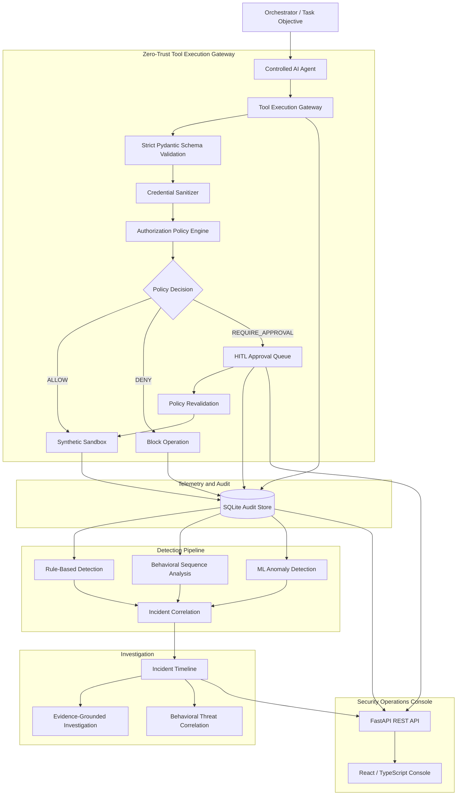

# AegisAI: Autonomous AI Agent Behavioral Security & Threat Investigation Platform

### An Empirical Research & Engineering Platform for Zero-Trust Tool Mediation, Human-in-the-Loop Governance, and Multi-Step Behavioral Attack Detection

[](https://www.python.org/)
[](https://fastapi.tiangolo.com/)
[](https://react.dev/)
[](https://www.typescriptlang.org/)
[](https://docs.pytest.org/)

---

## 1. Research Overview & Problem Statement

As autonomous AI agents acquire the ability to execute tools—including filesystem operations, database queries, web requests, and calculations—they introduce new security challenges.

AegisAI investigates the use of zero-trust mediation, behavioral analysis, and human oversight to help control potentially unsafe agent actions.

Key challenges include:

1. **Indirect Prompt Injection:** Malicious instructions embedded in untrusted documents or web pages may influence an agent to perform unauthorized operations.
2. **Privilege Creep and Scope Violations:** An agent may attempt operations outside its intended task or assigned permissions.
3. **Multi-Step Behavioral Attacks:** Reconnaissance, credential probing, and attempted data exfiltration may occur as sequences of individually plausible tool calls.
4. **Passive Observability Gaps:** Detecting an attack only after an operation executes may be too late. Security controls should evaluate sensitive actions before execution whenever possible.

### Core Research Questions

* **Primary:** Can least-privilege policies, behavioral sequence analysis, and unsupervised anomaly detection improve the identification and prevention of suspicious AI-agent behavior?
* **Secondary:** How do these detection approaches perform on held-out attack scenarios not explicitly encoded into static detection rules?
* **Governance:** Can human-in-the-loop approval workflows safely pause sensitive operations while preventing duplicate execution, race conditions, and unsafe recovery after interruptions?

---

## 2. System Architecture



### High-Level Request Flow

1. An agent proposes a tool operation.
2. The gateway validates the tool and its arguments.
3. The authorization policy engine evaluates the requested action.
4. The operation is allowed, denied, or paused for human approval.
5. Security events and execution outcomes are recorded.
6. Detection engines analyze events and behavioral sequences.
7. Related events are correlated into incidents for investigation.

---

## 3. Component Architecture & Responsibilities

| Component                          | Responsibility                                                                                                 |
| ---------------------------------- | -------------------------------------------------------------------------------------------------------------- |
| **Controlled AI Agent**            | Executes simulated tasks through controlled tool requests.                                                     |
| **Synthetic Sandbox**              | Provides mock resources, test documents, honeytokens, and simulated enterprise data.                           |
| **Tool Execution Gateway**         | Mediates tool calls before execution and applies authorization decisions.                                      |
| **Strict Tool Validator**          | Uses typed Pydantic schemas to validate tool arguments and reject unexpected parameters.                       |
| **Secret Sanitizer**               | Redacts sensitive-looking credentials and tokens from supported logs, responses, and errors.                   |
| **HITL Approval Engine**           | Manages approval-required operations, reviewer decisions, execution states, and recovery from stale approvals. |
| **Authorization Policy Engine**    | Evaluates tool permissions, resource restrictions, and operation scopes.                                       |
| **Rule-Based Detector**            | Identifies known suspicious patterns using configured rules.                                                   |
| **Behavioral Sequence Analyzer**   | Examines sequences of tool events to identify potentially suspicious multi-step behavior.                      |
| **ML Anomaly Detector**            | Uses engineered behavioral features and an Isolation Forest model to identify anomalous activity.              |
| **Incident Correlation Engine**    | Connects related security events and creates incident timelines.                                               |
| **Investigation Dossier Engine**   | Produces evidence-grounded investigation summaries using recorded event identifiers.                           |
| **Threat Intelligence Correlator** | Groups incidents based on behavioral similarities and shared targets.                                          |
| **Simulation Lab & Benchmarks**    | Runs synthetic scenarios and compares detection approaches using evaluation metrics.                           |

### Important Security Properties

* **Fail-closed authorization:** Unknown tools and invalid parameters should be rejected rather than implicitly trusted.
* **Least privilege:** Agents are restricted by configured tool permissions and resource scopes.
* **Human oversight:** Sensitive operations can require explicit approval.
* **Concurrency protection:** Approval state transitions are designed to prevent multiple reviewers from claiming the same operation for execution.
* **Stale approval recovery:** Interrupted operations can be marked as failed or uncertain rather than automatically retried.
* **Synthetic evaluation:** Security scenarios use mock resources and simulated attack behavior.

These controls reduce risk within the implemented prototype; they do not establish that every attack or execution failure is prevented.

---

## 4. Threat Model & Safeguards

| Threat Scenario                         | Example                                                                    | Intended Mitigation                                                                               |
| --------------------------------------- | -------------------------------------------------------------------------- | ------------------------------------------------------------------------------------------------- |
| **Indirect Prompt Injection**           | An untrusted document contains instructions to access sensitive mock data. | Apply tool authorization and configured resource restrictions.                                    |
| **Sandbox Path Traversal**              | A tool requests a path such as `../../etc/passwd`.                         | Validate resolved paths against the permitted sandbox directory.                                  |
| **Privilege Escalation**                | A read-only agent attempts a write operation.                              | Enforce tool permissions and operation scopes.                                                    |
| **Unauthorized Exfiltration**           | An agent attempts to send mock data to an unapproved domain.               | Apply configured network-domain restrictions before the operation executes.                       |
| **Suspicious Tool Sequences**           | Several individually plausible calls form a reconnaissance pattern.        | Analyze event sequences and behavioral anomalies.                                                 |
| **Approval Replay and Race Conditions** | Multiple requests attempt to approve the same pending operation.           | Use atomic state transitions and reject competing claims.                                         |
| **Interrupted Approval Execution**      | A process stops while an approval is in progress.                          | Recover stale operations without automatically repeating an operation whose outcome is uncertain. |

**Scope note:** These safeguards apply to the implemented mediation and synthetic execution environment. They should not be interpreted as proof of complete isolation from the host operating system or comprehensive protection against every real-world attack.

---

## 5. Getting Started & Installation

### Prerequisites

* **Python:** 3.10 or newer; compatibility should be verified for the specific version used.
* **Node.js:** Version 18 or newer.
* **npm:** A version compatible with the installed Node.js release.
* **Git:** Required to clone the repository.

### A. Clone the Repository

```bash
git clone https://github.com/yeshwanthreddynandigala-hub/AegisAI.git
cd AegisAI
```

### B. Create a Python Virtual Environment

**Windows PowerShell:**

```powershell
python -m venv venv
.\venv\Scripts\Activate.ps1
```

**Linux / macOS:**

```bash
python3 -m venv venv
source venv/bin/activate
```

If PowerShell blocks virtual-environment activation, you can invoke the environment's Python executable directly instead of changing your system-wide execution policy.

### C. Install Backend Dependencies

From the project root, with the virtual environment activated:

```bash
python -m pip install -r requirements.txt
```

### D. Install Frontend Dependencies

```bash
cd frontend
npm install
```

Return to the project root before running the backend commands.

---

## 6. Running the System

The backend and frontend run in separate terminals.

### Step 1: Initialize Demonstration Data

From the project root:

**Windows PowerShell:**

```powershell
$env:PYTHONPATH = "backend"
.\venv\Scripts\python.exe backend/app/core/seed.py
```

**Linux / macOS:**

```bash
PYTHONPATH=backend python backend/app/core/seed.py
```

**Important:** The seed script initializes demonstration data in the configured database. Back up any local data you need before running it.

### Step 2: Start the FastAPI Backend

Open a terminal at the project root.

**Windows PowerShell:**

```powershell
$env:PYTHONPATH = "backend"
.\venv\Scripts\python.exe -m uvicorn app.main:app --host 127.0.0.1 --port 8000 --reload
```

**Linux / macOS:**

```bash
PYTHONPATH=backend python -m uvicorn app.main:app --host 127.0.0.1 --port 8000 --reload
```

Interactive API documentation should be available at:

`http://127.0.0.1:8000/docs`

### Step 3: Start the React Console

Open a second terminal:

```bash
cd frontend
npm run dev
```

Open:

`http://localhost:5173`

### Step 4: Local Demonstration Authentication

> **Local Demo Only:** The application may provide default demonstration accounts through its seed or configuration logic. These accounts are intended for local evaluation only. Do not expose default credentials or development signing keys in a production deployment. Configure unique credentials and a strong, private JWT signing key before external deployment.

Use the demonstration credentials configured by the local seed process. Verify the current values in the project's configuration before relying on them.

---

## 7. Interactive Security Operations Console

The React interface provides a set of security monitoring and investigation views.

### 7.1 SOC Overview

* Displays security and activity counters.
* Summarizes gateway decisions and threat categories.
* Provides navigation to incident investigations.

### 7.2 Live Telemetry Monitor

* Presents a chronological event feed.
* Supports filtering and searching.
* Displays recorded tool-call details and gateway decisions.

### 7.3 Agent Explorer

* Displays configured agent identities and roles.
* Shows assigned objectives and policy restrictions.
* Helps reviewers inspect tool permissions and resource scopes.

### 7.4 Incident Dossier & Attack Timelines

* Displays chronological security-event sequences.
* Links investigation claims to recorded event identifiers.
* Provides context for understanding suspicious behavior.

### 7.5 Attack Simulation Lab

* Supports synthetic benign and malicious scenarios.
* Allows users to examine tool execution decisions.
* Displays resulting events and related incidents.

### 7.6 Human-in-the-Loop Approvals Inbox

The approval workflow supports operations that require human authorization.

A typical workflow is:

1. A tool request is evaluated by the policy engine.
2. If approval is required, the operation enters the pending queue.
3. An authorized reviewer examines the request and its context.
4. The reviewer approves or rejects the request, with the decision recorded in the audit trail.
5. Before an approved operation executes, the system revalidates the applicable policy.
6. Atomic state transitions help prevent multiple reviewers from claiming the same operation.
7. Stale in-progress approvals can be recovered to a failure or uncertain state without blindly retrying the operation.

The approval workflow is intended to improve accountability and prevent unsafe execution. It does not eliminate every possible failure caused by process termination or external side effects.

### 7.7 Evaluation Center

* Compares configured detection engines.
* Displays evaluation metrics for tested scenarios.
* Helps examine the trade-offs between detection, false positives, and latency.

### 7.8 Threat Correlation

* Groups incidents by behavioral similarities.
* Connects related targets and event sequences.
* Supports investigation without claiming that behavioral similarity establishes a real-world person's identity.

---

## 8. Empirical Research Findings & Benchmark Results

The existing evaluation describes four benign workflows, five known attack scenarios, and two held-out attack trajectories.

The reported benchmark results are:

| Detection Engine              | Precision | Recall | F1 Score | False Positive Rate | False Negative Rate | Held-Out Scenario Detection | Average Latency |
| ----------------------------- | --------: | -----: | -------: | ------------------: | ------------------: | --------------------------: | --------------: |
| Rule-Based Engine             |      1.00 |   0.71 |     0.83 |                0.00 |                0.29 |                          0% |         0.42 ms |
| Behavioral Sequence Analyzer  |      1.00 |   0.57 |     0.73 |                0.00 |                0.43 |                          0% |         0.58 ms |
| ML Anomaly Detector           |      0.88 |   1.00 |     0.93 |                0.25 |                0.00 |                        100% |         0.85 ms |
| Combined Multi-Engine Defense |      0.88 |   1.00 |     0.93 |                0.25 |                0.00 |                        100% |         0.95 ms |

*These are the results reported by the project's existing benchmark. They should be retained only if they match the actual evaluation output.*

### Interpretation

1. **Rule Generalization:** Static rules performed well on configured signatures but did not identify the held-out attack trajectories in this evaluation.
2. **Behavioral Sequence Analysis:** Tracking multiple events can reveal suspicious patterns that may not be apparent from an isolated tool call.
3. **ML Anomaly Detection:** The reported model flagged both held-out attack trajectories. Because only two held-out trajectories were evaluated, this result does not establish generalization to all unseen or real-world attacks.
4. **Gateway Enforcement:** The reported gateway blocking effectiveness was 100% on the evaluated scenarios. This is a result for that test set, not a guarantee that all unauthorized operations will always be blocked.

### Evaluation Limitations

* The benchmark uses a small, synthetic set of scenarios.
* Results depend on the configured rules, feature engineering, model settings, and evaluation methodology.
* A held-out synthetic scenario is not equivalent to a comprehensive real-world zero-day evaluation.
* Larger and more diverse datasets are needed to establish generalization, robustness, and performance under production workloads.

---

## 9. Automated Testing & Verification

The latest recorded project verification reported **69 backend tests passing**, along with a successful frontend production build.

These results describe the recorded verification run; they do not mean the tests were rerun when this README was edited.

### Run the Backend Tests

From the project root:

**Windows PowerShell:**

```powershell
$env:PYTHONPATH = "backend"
.\venv\Scripts\python.exe -m pytest backend/tests -v
```

**Linux / macOS:**

```bash
PYTHONPATH=backend python -m pytest backend/tests -v
```

### Test Coverage Reported by the Project

| Test Suite                        |  Tests | Focus                                                       |
| --------------------------------- | -----: | ----------------------------------------------------------- |
| `test_api_endpoints.py`           |      9 | REST endpoints, API schemas, and serialization              |
| `test_auth_rbac.py`               |     15 | Password hashing, JWT authentication, and role-based access |
| `test_end_to_end_pipeline.py`     |      3 | End-to-end security and incident pipeline                   |
| `test_hitl_approval.py`           |      8 | Approval workflow and policy revalidation                   |
| `test_phase3_hardening.py`        |     11 | Concurrency, secret redaction, and strict schemas           |
| `test_sequence_detector.py`       |      6 | Behavioral sequence analysis                                |
| `test_stage2_core.py`             |      6 | Sandbox restrictions and honeytoken detection               |
| `test_stale_approval_recovery.py` |      7 | Stale approval recovery and execution-state guarantees      |
| `test_timestamp_consistency.py`   |      4 | Timestamp persistence and serialization                     |
| **Total**                         | **69** |                                                             |

### Build the Frontend

From the frontend directory:

```bash
npm run build
```

A successful build indicates that the frontend's configured TypeScript and build steps completed. It does not, by itself, prove that every interface flow works correctly at runtime.

---

## 10. Technology Stack

* **Backend:** Python, FastAPI, Pydantic, SQLAlchemy, SQLite.
* **Security and Authentication:** BCrypt password hashing, JWT authentication, role-based access control, zero-trust tool mediation.
* **Machine Learning:** Isolation Forest and engineered behavioral features.
* **Frontend:** React, TypeScript, Vite, Tailwind CSS, Recharts, Lucide Icons.
* **Testing:** pytest, HTTPX, AnyIO.
* **Development and Version Control:** Git and GitHub.

---

## 11. Research Prototype Notice & Limitations

AegisAI is an educational and empirical research prototype for investigating security controls around autonomous AI-agent behavior.

### Deployment Constraints

* **Database Architecture:** The default setup uses local SQLite. A different database configuration may be needed for distributed or multi-user deployments.
* **Sandbox Isolation:** The project uses a synthetic environment and filesystem path restrictions. These are not equivalent to a dedicated operating-system sandbox or microVM boundary.
* **Host Side Effects:** If a process terminates during an operation, the final outcome may be uncertain. Marking an operation as failed does not necessarily reverse an external side effect.
* **Detection Generalization:** Synthetic benchmark performance does not establish detection against every real-world or previously unseen attack.
* **Authentication Configuration:** Default demonstration settings must not be reused for production deployment.
* **Operational Readiness:** Production use would require additional security testing, deployment hardening, monitoring, and review of data-handling requirements.

The system is intended to demonstrate security architecture concepts and provide a basis for further experimentation, not to serve as a certified production security boundary.

---

## 12. License & Academic Integrity

This project was developed as an educational and empirical research software system studying autonomous AI-agent behavior security and zero-trust mediation architectures.

No open-source license has been specified for this repository yet.

---

## Project Summary

**AegisAI** explores how zero-trust tool authorization, behavioral sequence analysis, anomaly detection, incident correlation, and human approval can work together to improve the security and accountability of autonomous AI-agent operations.

The project combines a Python/FastAPI backend, a React/TypeScript security console, a synthetic testing environment, and an automated test suite to support experimentation with AI-agent security controls.
