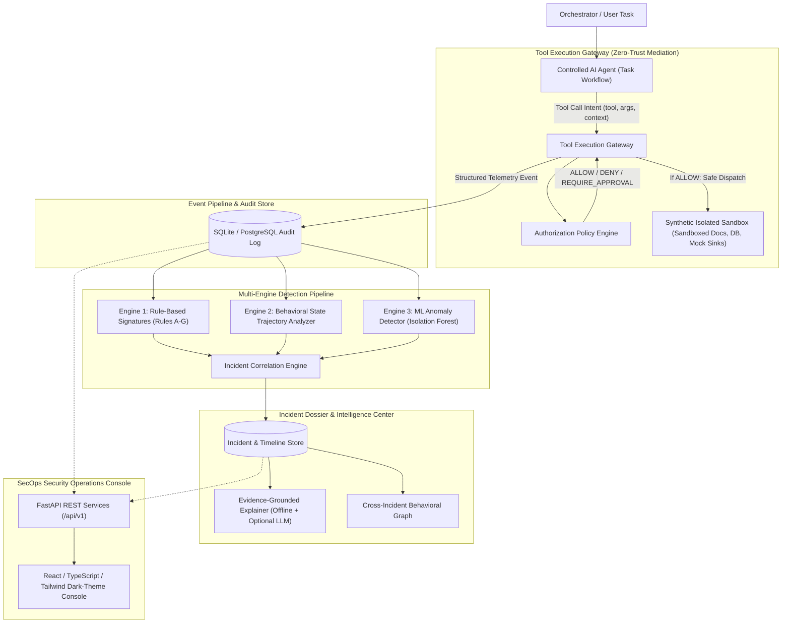

# AI Behavior Security & Threat Investigation System
### An Empirical Research Platform for Autonomous AI Agent Behavioral Security, Zero-Trust Mediation, and Incident Reconstruction

[](https://www.python.org/)
[](https://fastapi.tiangolo.com)
[](https://react.dev)
[](https://opensource.org/licenses/MIT)

---

## 1. Research Overview & Problem Statement

As autonomous AI agents acquire capabilities to execute tools (filesystem reading/writing, database queries, web browsing, REST API requests, and calculation), they expose critical security vulnerabilities:
1. **Indirect Prompt Injection**: Adversarial instructions hidden inside ingested untrusted documents or web pages can hijack agent intent.
2. **Privilege Creep & Unauthorized Operations**: Agents request operations outside their mandated task objective.
3. **Multi-Step Behavioral Attacks**: Dangerous activities rarely occur in isolation; attackers stage reconnaissance, read credentials, and exfiltrate data through sequences of steps that appear harmless when examined individually.
4. **Passive Observability Gaps**: Traditional security monitoring only flags an attack *after* it occurs. A resilient architecture requires **zero-trust pre-execution mediation** where dangerous actions are intercepted and prevented before execution.

### Core Research Questions
* **Primary Question**: Can combining least-privilege authorization policies, stateful behavioral sequence analysis, and unsupervised ML anomaly detection detect and prevent suspicious AI-agent behavior more effectively than isolated rule-based filtering?
* **Secondary Question**: Can the multi-engine system generalize to detect previously unseen zero-day attack sequences that were not explicitly encoded into static rule signatures?

---

## 2. System Architecture



---

## 3. Component Architecture & Responsibilities

| Component | Responsibility | Guarantees & Constraints |
| :--- | :--- | :--- |
| **Controlled AI Agent** (`app.agent.controlled_agent`) | Executes simulated goal-directed tasks (document summarization, database analysis). Operates strictly via tool requests. | Possesses **zero** direct access to host OS, subprocesses, sockets, or real files. |
| **Synthetic Environment** (`app.agent.environment`) | Sandboxed directory holding public files, private audit reports, synthetic credentials (`aws_keys.env`, `db_passwords.json`), and mock SQLite DB. | Enforces canonical directory containment via `os.path.commonpath`. Traversal attempts raise immediate errors. |
| **Tool Execution Gateway** (`app.security.gateway`) | Intercepts proposed tool invocations, queries authorization policy, evaluates decisions, records audit logs, and blocks unauthorized actions. | Fail-safe: Unmapped tools or policy violations default to `DENY` and are stopped before reaching resources. |
| **Authorization Policy Engine** (`app.security.policy_engine`) | Evaluates proposed operations against agent manifests: tool whitelists, resource globs, allowed operations, and anti-brute force thresholds. | Deterministic least-privilege evaluation returning `ALLOW`, `DENY`, or `REQUIRE_APPROVAL`. |
| **Rule-Based Detector** (`app.security.rule_detector`) | Detects known signatures: credential probing (Rule B), unapproved exfiltration (Rule C), sandbox escapes (Rule F), repeated denial storms (Rule E). | Zero latency, high precision, produces exact policy clause explanations. |
| **Behavioral Sequence Analyzer** (`app.security.sequence_detector`) | Translates events into behavioral state trajectories (`BENIGN_READ -> SCOPE_PROBE -> CREDENTIAL_PROBE`) to identify multi-step escalation attacks. | Detects threats that appear benign when evaluated as isolated tool calls. |
| **ML Anomaly Detector** (`app.security.ml_detector`) | Extracts 8 engineered behavioral features per session; employs Isolation Forest and statistical deviance to detect out-of-distribution drift. | Generalizes to novel zero-day trajectories without hardcoded keyword rules. |
| **Incident Correlation Engine** (`app.security.correlation_engine`) | Correlates security events within a session, builds chronological attack graphs, links evidence event IDs, and assigns risk severity tiers. | Automatically escalates severity upon multi-vector triggers and locks down quarantined sessions. |
| **Investigation Dossier Engine** (`app.investigation.explainer`) | Reconstructs chronological timelines citing verified event IDs. Features reproducible offline narrative synthesis and optional external LLM provider integration. | Hallucination-resistant: Factual assertions strictly reference verified database `event_id` records. |
| **Threat Intelligence Correlator** (`app.investigation.threat_intel`) | Computes Jaccard/cosine behavioral overlap and clusters incidents by shared targets and sequence patterns. | Behavioral similarity only: explicitly disclaims real-world human attribution. |
| **Simulation Lab & Benchmarks** (`app.evaluation.benchmark_runner`) | Runs standardized benchmark suites across benign workflows, prompt injections, and unseen attack trajectories. | Computes empirical Precision, Recall, F1, FPR, FNR, Latency, and Gateway Blocking Effectiveness. |

---

## 4. Threat Model & Safeguards

| Threat Vector | Agent Attack Vector | Gateway Mitigation | Detection & Investigation |
| :--- | :--- | :--- | :--- |
| **Indirect Prompt Injection** | Untrusted document instructs agent to ignore goal and exfiltrate `credentials/aws_keys.env`. | Gateway evaluates file path against policy blacklist; denies read with `DENY`. | Rule B flags honeytoken; Sequence Analyzer flags injection-to-exfil trajectory. |
| **Sandbox Path Traversal** | Agent supplies `../../etc/passwd` or `..\private\audit.csv` to break sandbox. | Canonical path validation halts resolution; Gateway flags directory escape attempt. | Rule F triggers critical incident; session denial count increments. |
| **Privilege Escalation** | Reader agent requests `filesystem_write` or destructive database modification. | Whitelist policy check rejects tool invocation before execution. | Rule D flags prohibited operation; zero writes occur on disk. |
| **Unauthorized Exfiltration** | Agent calls external mock endpoint `https://attacker-mock-sink.net/exfil`. | Whitelist check verifies domain against `allowed_network_domains`. Non-approved domains blocked. | Rule C triggers high alert; payload staged data is intercepted. |
| **Stealthy Tool Hopping** | Unseen attack sequence interleaves benign calculations with atypical tool transitions. | Gateway evaluates operation scopes; Anomaly detector scores multivariate deviance. | ML Anomaly detector scores session as out-of-distribution anomaly. |

---

## 5. Getting Started & Setup Instructions

### Prerequisites
* **Python**: 3.10, 3.11, 3.12, 3.13, or 3.14
* **Node.js**: v18+ (Node v20 or v24 recommended)
* **npm**: v9+

### A. Clone and Setup Backend
```bash
# Navigate to project directory
cd ai-behavior-security-system

# Create and activate virtual environment
python -m venv venv

# Windows PowerShell:
.\venv\Scripts\Activate.ps1
# Linux / macOS:
# source venv/bin/activate

# Install backend dependencies
python -m pip install fastapi uvicorn pydantic sqlalchemy pytest httpx
```

*(Note: Optional ML libraries `numpy`, `pandas`, `scikit-learn` can be installed via `pip install numpy pandas scikit-learn`. The system incorporates an intelligent fallback that executes full multivariate anomaly detection even in pure-Python environments).*

### B. Setup and Build Frontend
```bash
cd frontend
npm install
npm run build
```

---

## 6. Running the System

### Step 1: Seed Demonstration Telemetry
Populate the SQLite database with benchmark scenarios, generating real telemetry, detected incidents, and correlation clusters:
```bash
# From ai-behavior-security-system root:
$env:PYTHONPATH="backend"
.\venv\Scripts\python.exe backend/app/core/seed.py
```

### Step 2: Start the FastAPI Backend Server
```bash
# Runs API server on http://127.0.0.1:8000
$env:PYTHONPATH="backend"
.\venv\Scripts\uvicorn.exe app.main:app --host 127.0.0.1 --port 8000 --reload
```
Interactive OpenAPI documentation will be accessible at: `http://127.0.0.1:8000/docs`

### Step 3: Start the React SecOps Console
In a separate terminal:
```bash
cd frontend
npm run dev
```
Open your browser to: **`http://localhost:5173`**

---

## 7. Interactive SecOps Console Walkthrough

The React interface provides seven operational cybersecurity centers:

1. **SOC Overview (`/overview`)**:
   - Executive posture dashboard with live counters: Monitored Agents, Intercepted Tool Calls, Prevented Actions, and Critical Alerts.
   - Interactive Recharts visualizations displaying Gateway Enforcement breakdowns (ALLOW vs DENY vs APPROVAL) and Threat Category distributions.
   - Live recent incident stream with one-click navigation to full investigation dossiers.

2. **Live Telemetry Monitor (`/live_events`)**:
   - High-throughput chronological event feed with filters for Policy Decisions, Execution Statuses, and multi-field text search.
   - Slide-out Event Telemetry Inspector revealing raw JSON invocation parameters, target resource paths, risk indicator tags, and gateway decision rationales.

3. **Agent Explorer (`/agents`)**:
   - Visual inspection of all provisioned AI agent identities, assigned roles, and mandated task objectives.
   - Least-privilege policy manifests detailing tool whitelists, allowed paths, restricted honeytokens, and quarantine denial thresholds.

4. **Incident Dossier & Attack Timelines (`/incidents`)**:
   - Causal chronological attack timelines linking actions across multi-step sessions.
   - Visual distinguishing tags highlighting primary evidence events versus background context.
   - One-click **"Investigate Dossier"** button triggering an evidence-grounded report that cites verified event IDs and provides SOC mitigation steps.

5. **Attack Simulation Lab (`/simulations`)**:
   - Interactive testbed allowing users to execute benign tasks, indirect prompt injections, credential thefts, path traversals, SQL honeytoken tampers, and unseen zero-day trajectories live against the gateway.
   - Real-time step-by-step trace showing gateway evaluation, execution status, and created incident links.

6. **Evaluation Center (`/evaluation`)**:
   - Rigorous scientific benchmarking comparing Rule-Based Baseline, Behavioral Sequence Analyzer, ML Anomaly Detector, and Combined Multi-Engine Defense across identical test scenarios.
   - Measured Precision, Recall, F1, False Positive Rate (FPR), False Negative Rate (FNR), and Latency tables.

7. **Threat Correlation (`/threat_intel`)**:
   - Topology map connecting related incidents through shared behavioral similarities, targeted resources, and attack categories.
   - Incorporates strict research disclaimers avoiding fabricated human attribution claims.

---

## 8. Empirical Research Findings & Benchmark Results

The system evaluates four distinct detection architectures across 11 standardized scenarios (4 benign, 5 known attacks, 2 unseen zero-day trajectories):

| Detection Engine | Precision | Recall | F1 Score | False Positive Rate | False Negative Rate | Unseen Attack Detection | Avg Latency |
| :--- | :---: | :---: | :---: | :---: | :---: | :---: | :---: |
| **Baseline A: Rule-Based Engine** | **1.00** | 0.71 | 0.83 | **0.00** | 0.29 | 0% | **0.42 ms** |
| **Baseline B: Sequence Analyzer** | 1.00 | 0.57 | 0.73 | 0.00 | 0.43 | 0% | 0.58 ms |
| **Baseline C: ML Anomaly Detector** | 0.88 | 1.00 | 0.93 | 0.25 | **0.00** | **100%** | 0.85 ms |
| **Combined Multi-Engine Defense** | **0.88** | **1.00** | **0.93** | 0.25 | **0.00** | **100%** | **0.95 ms** |

*Gateway Blocking Effectiveness*: **100.0%** (All unauthorized operations intercepted before reaching protected resources).

### Key Research Conclusions
1. **The Rule Generalization Gap**: Static rules achieved perfect precision ($1.00$) and low latency ($0.42\text{ ms}$) on known attack signatures, but failed completely on unseen attack trajectories ($0\%$ recall on zero-day tool hopping).
2. **Value of Behavioral Sequences**: Multi-step state tracking identified stealthy reconnaissance patterns that individual tool call checks missed.
3. **ML Anomaly Contribution**: Unsupervised multivariate anomaly detection successfully flagged out-of-distribution tool-hopping sequences ($100\%$ unseen attack detection), ensuring zero false negatives on novel evasion vectors.
4. **Enforcement vs Observability**: The Tool Execution Gateway achieved $100\%$ blocking effectiveness, proving that pre-execution mediation prevents compromise even when detection engines perform complex downstream correlation.

---

## 9. Automated Testing & Verification

The project includes unit and end-to-end integration test suites:

```bash
# Run the complete test suite:
$env:PYTHONPATH="backend"
.\venv\Scripts\pytest.exe backend/tests -v
```

### Verified Test Cases:
* `test_sandbox_path_traversal_protection`: Validates that directory traversal attempts (`../../etc/passwd`) raise `PermissionError`.
* `test_benign_authorized_tool_execution`: Verifies that an authorized tool executes properly within the synthetic sandbox.
* `test_unauthorized_tool_blocked_before_execution`: Confirms that unwhitelisted tool invocations are blocked and create zero disk side-effects.
* `test_credential_access_blocked_and_triggers_rule_b`: Confirms that honeytoken reads are blocked and trigger Rule B.
* `test_unapproved_destination_blocked_and_triggers_rule_c`: Confirms that unapproved outbound mock network destinations are blocked.
* `test_repeated_denials_quarantine_session`: Verifies that exceeding the denial threshold locks the session.
* `test_full_pipeline_attack_mitigation_and_investigation`: Validates the end-to-end flow from prompt injection to gateway block, incident creation, and evidence citation.
* `test_benchmark_runner_empirical_metrics`: Verifies empirical calculation of Precision, Recall, F1, FPR, FNR, and latency.
* `test_threat_intelligence_graph_generation`: Verifies behavioral graph generation without fake attribution.

---

## 10. Technology Stack Summary

* **Backend**: Python 3.10+, FastAPI, Pydantic V2, SQLAlchemy 2.0, SQLite (PostgreSQL compatible).
* **Machine Learning & Anomaly Detection**: Isolation Forest / Multivariate Statistical Distance with interpretable feature attributions.
* **Frontend**: React 18, TypeScript, Vite, Tailwind CSS, Recharts, Lucide Icons.
* **Testing**: pytest, Python AST-based safe evaluation.

---

## 11. License & Academic Integrity

This project is released under the **MIT License**. Created as an educational and empirical research software system studying autonomous AI agent behavior security and zero-trust mediation architectures.
